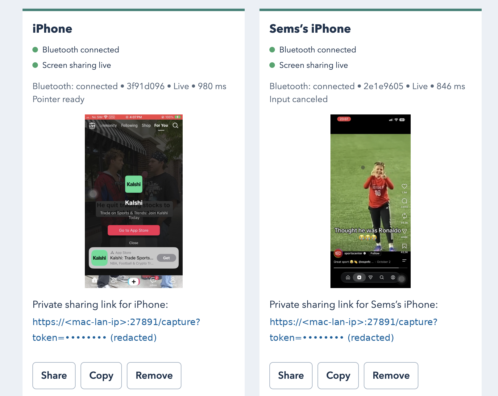

# Open iPhone Use

Control your own iPhones with a local CLI server, Bluetooth HID, Safari screen sharing and an
image-capable MCP agent. Multiple phones can run at once, each with its own input queue,
frames and calibration. The server contains no model or AI API key.

The **macOS app and DMG are deprecated and removed**; use the CLI. The `macos/` Swift
package supplies the headless Bluetooth HID helper used on macOS and retains a legacy MCP
compatibility test surface.

## Quick start

From a reviewed checkout on macOS or Linux:

```sh
sh setup.sh
open-iphone-use serve
```

On Windows:

```powershell
.\setup.ps1
open-iphone-use serve
```

Setup installs a managed runtime and the `open-iphone-use` CLI. It registers MCP for detected
Codex, Claude Code, Cursor, OpenCode and Command Code clients, and installs the agent skill
at `~/.agents/skills/open-iphone-use`; detected Claude Code and Command Code clients get
aliases to it (Windows can use a junction or copy fallback). Restart clients after setup.
Run `open-iphone-use register-agents` to register clients installed later. macOS needs Swift 6;
see [installation](docs/installation.md) for platform dependencies and options.

`serve` runs headless in the background; use `open-iphone-use serve --foreground` for
debugging and `open-iphone-use stop` to stop it. It is not a login or reboot service.
Open the Web UI at **http://127.0.0.1:27893**: it is loopback-only and needs no token.
Any local process can operate it, so do not expose it through a proxy. Each device card
shows independent green/red Bluetooth and screen-sharing lights, a live thumbnail and
frame age.



## Pair and share each iPhone

1. Unlock the iPhone, enable AssistiveTouch, then pair the host under **Settings →
   Accessibility → Touch → AssistiveTouch → Devices → Bluetooth Devices**. Approve the
   owner's pairing prompts. Both keyboard and pointer HID subscriptions must be connected.
2. Choose the connected phone in the Web UI or run `open-iphone-use new` (`add` is an
   alias). `open-iphone-use bluetooth` lists candidates; `new --bt PEER_ID` selects an exact
   peer. Bluetooth supplies owner device names where available; generic or duplicate names
   get fallbacks. Do not infer identity from a name.
3. Each phone gets a private sharing link and QR. Use Copy or, where supported, Share and
   the system share sheet (including AirDrop where available). On first use install the
   public CA on the phone, verify its SHA-256 fingerprint against the terminal, and enable
   trust in **Settings → General → About → Certificate Trust Settings**. Open that phone's
   link in Safari and approve **Start sharing**. Repeat for each phone.

The capture page requests video at an ideal **30 fps**; actual delivery depends on the
phone and network. Capture links are credentials: keep them private. Only the owner pairs,
trusts certificates, unlocks the phone and approves sharing. Bluetooth and fresh screen
sharing are both required for control.

```sh
open-iphone-use devices                    # list registered phones
open-iphone-use status --device DEVICE_ID  # inspect a phone
open-iphone-use link DEVICE_ID             # show its link and QR again
open-iphone-use remove DEVICE_ID           # remove phone and revoke its link
open-iphone-use stop
```

`remove --device DEVICE_ID` is also supported. Removal cancels that phone's input and clears
its frames and calibration; it does not remove its OS Bluetooth bond. See
[headless server](docs/headless-server.md) for reconnect and network details.

## Pointer and MCP

The default auto-hiding AssistiveTouch pointer is supported. With Safari sharing visible,
preparation measures seven samples on its calibration board and fits the visual pointer;
a good fit is accepted immediately, while a poor fit is remeasured once. Compatible
calibration is reused. Explicitly recalibrate with `ensure_session` or `prepare_session`
using `recalibrate=true`, or Safari's **Calibrate pointer** button. After a failed automatic
attempt, another automatic attempt can be made after three minutes; a failed explicit attempt
preserves the stored mapping. Keep pointer appearance, tracking speed, Zoom and orientation
stable.

Coordinate taps use bounded corrections and learn consistent landing offsets. Results report
whether the landing was visually verified, observed without verification, predicted, or blind;
predicted and blind results are unverified. A tap is refused when an observed landing is over 3% off target, a hidden
corrected pointer is predicted over 1% off, or an unseen pointer has untrusted calibration.
Even a verified landing does not prove the intended UI changed: inspect the screen after
**every action**.

The portable MCP server exposes:

- Device setup and status: `list_bluetooth_candidates`, `create_device`, `remove_device`,
  `list_devices`, `get_device_status`, `get_latest_screenshot`, `stop_control`.
- Preparation and pointer: `ensure_session`, `prepare_session`, `pointer_quick_probe`,
  `pointer_home`, `pointer_move`, `pointer_tap`, `move_pointer`, `click`, `set_page_board`.
- Input and navigation: `type_text`, `send_key`, `scroll`, `swipe`, `advance_feed`.

Select an explicit device and inspect its screenshot. Preparation takes its own fresh frames;
other input requires a frame ID captured after that phone's last input, at most 120 seconds
old, while screen sharing remains active with a frame received within five seconds. Results
include image dimensions; coordinates are fractions of the full image. Input is serialized
per device and released on cancellation. Stale frames and unavailable control are rejected;
HID delivery alone does not establish UI success. Text uses the US ASCII layout, and iOS
permissions, protected content and locking remain in force.

macOS has been tested with an iPhone. Linux/BlueZ and Windows/WinRT backends exist and should
work in principle, but have **not been tested on real hardware**; reports and pull requests
are welcome. On macOS, two iPhones have been shared and connected at the same time, and a
paired iPhone reconnected over Bluetooth within a few seconds after a server restart. See the
[validation record](docs/web-server-validation.md) for what was actually tested.

Read the [changelog](CHANGELOG.md), [documentation](docs/), and
[contributing guide](CONTRIBUTING.md).
