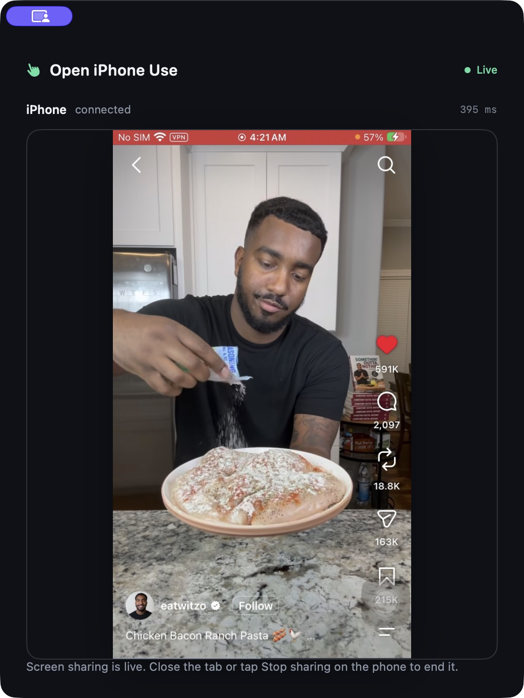
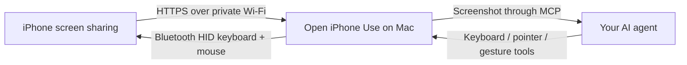
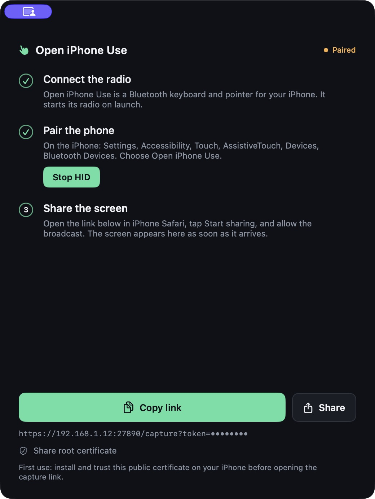
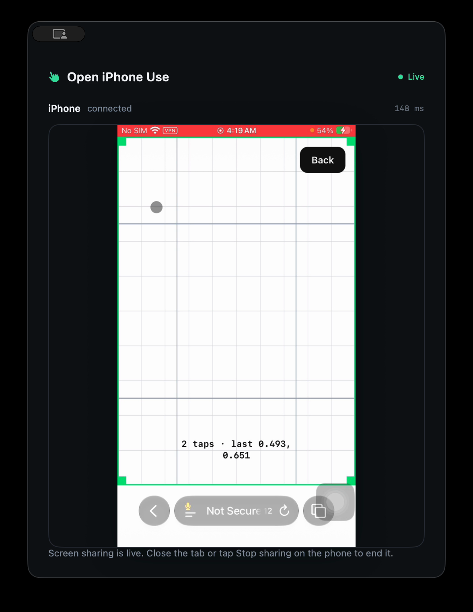

<div align="center">

# Open iPhone Use

**Give your AI agent a real iPhone to use.**

Your Mac becomes a Bluetooth keyboard and mouse. Your iPhone shares its screen over
Wi-Fi. Connect the two to any image-capable MCP agent.

[Download 0.0.1](https://github.com/semsturgut/open-iphone-use/releases) ·
[Website](https://semsturgut.github.io/open-iphone-use/) ·
[Setup](#get-started) · [How it works](#how-it-works) · [Roadmap](ROADMAP.md)

**macOS · Apple Silicon · MCP · Apache-2.0 · Experimental 0.0.1**



</div>

## Requirements

- **Just an iPhone and an Apple Silicon Mac or MacBook.** No additional hardware needed.
- **No app installation on your iPhone.** Open the sharing link in Safari.
- Bluetooth enabled and both devices on the same trusted private Wi-Fi.
- An image-capable MCP client to connect your AI agent.

**Download the macOS DMG to get started** — the Mac app includes the local receiver
and MCP server. No separate server installation is needed. Follow the
[one-time setup](#get-started) to pair the phone, approve screen sharing and connect your agent.

**Windows and Linux support are on the [roadmap](ROADMAP.md).** The current binary
supports Apple Silicon macOS only.

## See it work

https://github.com/user-attachments/assets/9faccc34-7bd1-4714-a1a4-e8bb747bfb53

The demo searches Instagram in English for food, opens a cooking video, watches it,
advances to another video, and likes a food video. Actions go through the bundled MCP
server and Bluetooth HID; the Mac window shows live iPhone screen frames. No iPhone
Mirroring, deep-link navigation or simulated phone UI is used.

## How it works



Open iPhone Use supplies the screen and input tools. Your MCP client supplies the model.
No separate server or model API key is needed in the Mac app. If your client uses a
remote model, it may send screenshots to that provider; this is not a claim of local inference.

Use any MCP client that supports images and tool use. **GPT-6 Luna, Claude Haiku 5.5,
or newer models with strong vision/computer-use skills are recommended starting points**
when available in your client. Model selection is our practical recommendation, not a
compatibility guarantee or vendor endorsement. [OpenAI model capabilities](https://developers.openai.com/api/docs/models),
[Claude model information](https://www.anthropic.com/news/models).

## Get started

### 1. Install and open the Mac app

Download the **macOS arm64 DMG** from [Releases](https://github.com/semsturgut/open-iphone-use/releases),
open it, and drag **Open iPhone Use.app** into **Applications**. Keep the app open.
Its Bluetooth radio and private Wi-Fi receiver start automatically.

With the DMG still open, run **Install Open iPhone Use.command** once. It installs the
`open-iphone-use` CLI and shared agent skill, then registers the MCP server globally in any
detected OpenCode and DeepSeek Harness desktop profile. Restart those clients if they were
already open. For a manual install, run
`/Applications/Open iPhone Use.app/Contents/Helpers/open-iphone-use install`.

0.0.1 is a **development-signed, non-notarized alpha**, not a Developer ID
notarized release. macOS may block it. Review the source and build it yourself if you
cannot approve experimental software under your security policy. The supplied DMG
supports Apple Silicon; Intel, Linux and Windows binaries are not provided yet.



### 2. Pair the iPhone as a keyboard and pointer

Allow the Mac app's Bluetooth prompt. On the iPhone, enable **Settings → Accessibility →
Touch → AssistiveTouch**. Under **Devices → Bluetooth Devices**, choose **Open iPhone Use**
and approve pairing. Keep your iPhone unlocked. This is a Bluetooth HID connection:
the phone sees a keyboard and mouse, not a remote desktop app.

### 3. Share the screen over Wi-Fi

Keep the Mac and iPhone on the same trusted private Wi-Fi. In the Mac app:

1. Use **Share root certificate** to transfer the public certificate through a trusted
   channel such as AirDrop.
2. On iPhone install the certificate and explicitly enable trust under **Settings →
   General → About → Certificate Trust Settings**. This is an owner action.
3. Use **Copy link** or **Share** to open the app's capture link in iPhone Safari.
4. Tap **Start sharing** and approve iOS's screen-sharing prompt.

The capture link is private. The Mac masks its token on screen; never publish the copied
link. Keep Safari visible for first calibration. iOS can pause/end capture, and only the
owner can approve sharing again. The iPhone needs no app installation: its built-in
Safari opens the Mac's sharing page.

### 4. Connect your agent through MCP

The DMG installer connects OpenCode and DeepSeek Harness automatically when installed.
For another MCP client, register the bundled executable as a **stdio** server:

```text
/Applications/Open iPhone Use.app/Contents/Helpers/open-iphone-use-mcp
```

Example JSON configuration (adapt the container key to your client):

```json
{
  "mcpServers": {
    "open-iphone-use": {
      "command": "/Applications/Open iPhone Use.app/Contents/Helpers/open-iphone-use-mcp"
    }
  }
}
```

Reconnect the MCP server after installation/upgrades so the client refreshes its tools.
The Mac app must be running. No repository working directory or model-provider key is
required. Registration is per client, then available in that client's new chats. MCP
instructions and the installed agent skill tell the agent to use these tools when you ask
it to do something on the paired iPhone, even if you do not name the product. The
client/model must expose MCP tools, load server instructions or agent skills, and support
image-based tool use.

The `open-iphone-use` CLI can also check or configure clients:

```sh
open-iphone-use status
open-iphone-use setup --all
```

### 5. Let it calibrate, then give it a task

Ask, for example: **“On my iPhone, open Instagram and search for easy dinner recipes.”**
The MCP workflow starts with `ensure_session`. If needed, it opens a white calibration
board, moves to two points and measures **two clicks**. There is no lengthy profile scan.
Keep the sharing page visible until it finishes. Compatible calibration is then reused
across chats without moving away from your current app.



The result is a two-point estimate, not guaranteed accuracy at every pixel. Calibration
is bound to the paired phone, aspect, motion profile and version. Changing pointer
settings or phone can require recalibration. It stops before pressing if it cannot see
the pointer safely inside the board.

### 6. Check the connected view

The Mac window shows **Live**, the received iPhone screen and frame age. After every
action, the agent inspects a new image before continuing. Your phone remains under your
control; screen lock and protected content are not bypassed.


For Reels/Shorts, the agent uses `advance_feed`: press, drag, release, then verify the
account/title changed. Normal lists use `scroll`. [Feed control](docs/feed-control.md).

## Difference with iPhone Mirroring

| | Open iPhone Use | Apple's iPhone Mirroring |
| --- | --- | --- |
| Purpose | Give MCP agents screen and input tools | Interact with iPhone apps from a Mac |
| Input | Mac advertises as Bluetooth HID keyboard/mouse | Apple's integrated mirroring/control feature |
| Screen | Owner-approved sharing to a local HTTPS receiver over Wi-Fi | Apple's built-in wireless mirroring |
| Phone state | Unlocked phone and active sharing required | iPhone stays locked during mirroring |
| Account | No Apple Account sign-in in this app | Same Apple Account with two-factor authentication required |
| Agent interface | Bundled standard MCP stdio server | No MCP server supplied by this project for Apple's feature |
| Platforms today | Experimental Apple Silicon Mac build | Supported Apple hardware/macOS/iOS combinations |

We do not call or wrap iPhone Mirroring. Apple's implementation also uses Wi-Fi and
Bluetooth; the distinction is the HID + owner-approved capture + MCP architecture, not
an assertion that Apple's feature lacks keyboard/mouse interaction. Apple's current
requirements and behavior are documented in [Apple's guide](https://support.apple.com/en-us/120421).

## Current evidence and limits

On one paired 750×1334 portrait iPhone, two-click preparation took 3.53 seconds and
compatible reuse 79 ms. Two independent board targets had a worst-axis miss of 1.22%.
Reels and Shorts passed six inspected next/previous gestures. These are limited physical
observations, not benchmarks or proof on every iPhone. [Device checks](docs/device-matrix.md).

Text currently uses supported US-layout ASCII. No multi-touch, automatic unlock,
permission approval or protected-screen bypass is provided. Stale capture blocks input.
Inspect each resulting screen; HID delivery alone is not proof of UI success.

## Build from source

```sh
git clone https://github.com/semsturgut/open-iphone-use.git
cd open-iphone-use/macos
swift test
./build-app.sh
```

The default source-build destination is `~/Applications/Open iPhone Use.app`.
Use that installation's helper path when configuring MCP. To build the DMG:

```sh
./build-dmg.sh
```

Xcode 26.2 (including its SDK and Swift toolchain) and macOS are required to build from source. [Mac development](macos/README.md),
[contributing](CONTRIBUTING.md), [architecture](docs/architecture.md), [security](SECURITY.md).

## Roadmap

- **Linux and Windows builds** — planned, not implemented.
- **ESP32 support** — planned standalone Bluetooth HID control; target is an iPhone and
  ESP32 with no Mac/computer needed during use.
- **Raspberry Pi support** — planned compact host for screen capture, MCP and device
  control without a Mac/PC in the setup.
- **Multi-iPhone support** — planned; the current bridge controls one paired phone.
- Clean-machine compatibility tests, reconnect handling and a signed/notarized release.

See [ROADMAP.md](ROADMAP.md). This repository starts with a new clean history for Open
iPhone Use; private development history and credentials are not included.

## License

[Apache License 2.0](LICENSE). Not affiliated with Apple, OpenAI, Anthropic or Instagram.
