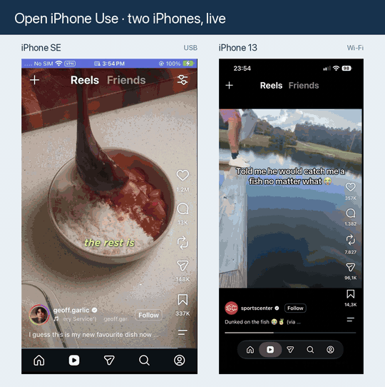

# Open iPhone Use

Let an AI agent use your own iPhone. Connect the phone to your Mac by cable or Wi-Fi, and
Open iPhone Use streams its screen live and taps, swipes, types and presses buttons on it
through Xcode's CoreDevice services. Your agent connects over MCP. The server contains no
model or AI API key.

- **Live screen:** the same HEVC stream Xcode mirrors, about 45 frames per second over USB.
- **Exact input:** touches land on the exact pixel, so there is no pointer to calibrate. Text,
  key chords and the Home, Lock, volume and Siri buttons work too.
- **Nothing on the phone:** no app, no Bluetooth pairing, no certificate, no Safari tab.



> **Using Xcode 26 or iOS 26?** Install
> [v0.0.3](https://github.com/semsturgut/open-iphone-use/releases/tag/v0.0.3), the last release
> that works without Xcode 27 (Bluetooth HID and Safari screen sharing):
> `curl -fsSL https://raw.githubusercontent.com/semsturgut/open-iphone-use/main/install.sh | bash -s -- --version v0.0.3`

## Requirements

- A Mac with **Xcode 27 or later**. Open Xcode once while the iPhone is connected, so it
  installs its developer tools on the phone.
- An iPhone on **iOS 27 or later**, connected by USB, with **Trust This Computer** accepted.
- **Developer Mode** on the iPhone: **Settings → Privacy & Security → Developer Mode**. The
  phone restarts and asks you to confirm.
- If the phone shows **Settings → Developer → UI Automation**, turn it on.

## Quick start

```sh
curl -fsSL https://raw.githubusercontent.com/semsturgut/open-iphone-use/main/install.sh | bash
```

```sh
open-iphone-use serve
```

```sh
open-iphone-use new
```

`serve` starts in the background and prints a `Web UI:` link (`http://127.0.0.1:27893`).
`new` adds the connected phone; with several phones it asks which one, or takes
`--udid UDID` (`open-iphone-use candidates` lists them). You can also select **Add phone** in
the Web UI.

**Watch it live.** The Web UI shows each phone's screen live; click the screen to tap. It is
loopback-only and needs no token, so any local process can operate it: do not expose it
through a proxy.

```sh
open-iphone-use devices                    # list added phones
open-iphone-use status --device DEVICE_ID  # connection details
open-iphone-use remove DEVICE_ID           # remove a phone and stop its control
open-iphone-use stop                       # stop the server
```

To uninstall:

```sh
curl -fsSL https://raw.githubusercontent.com/semsturgut/open-iphone-use/main/install.sh | bash -s -- --uninstall
```

See [installation](docs/installation.md) for options and development setup.

## Wi-Fi

Once Xcode has paired the phone over a cable, macOS can also reach it wirelessly. When the
cable is unplugged and both are on the same network, the phone shows up as **Wi-Fi** in
`open-iphone-use candidates` and the Web UI, and can be added and controlled without the
cable. If it does not appear, open Xcode's Devices window once with the phone nearby. The phone and Mac must be on the same network. Over Wi-Fi the screen arrives at a lower
frame rate and a softer picture: the stream is capped at 2 Mbit/s there to save radio traffic and
heat. For long sessions, prefer the cable.

To reconnect, plug the cable back in or bring the phone onto the same Wi-Fi: the server keeps
retrying and the phone's screen comes back in the Web UI by itself. Added phones are remembered
across server restarts.

## MCP

Setup registers the MCP server and agent skill for detected clients (Codex, Claude Code,
Cursor, OpenCode, Command Code, Antigravity). Agents can find controls through accessibility.
Visual targeting also needs an image-capable model.

- Use `get_ui_tree(device_id)` for compact `ref|action|role|label|value` rows, then
  `tap_ref(device_id, ref)` to touch a control. Ref calls check the live element token,
  geometry, visibility, enabled state and frontmost hit target. Changed or covered targets
  are refused before touch input. Refs expire after 120 seconds or reconnect.
- Use `batch(device_id, steps)` for up to 16 ordered steps under one device lock. Every step
  supplies `operation` and its arguments. Supported operations are `tap_ref`, `get_ui_tree`,
  `type_text`, `send_key`, `scroll`, `swipe` and `advance_feed`. A failed step stops the batch. Execution has an 80-second total budget.
  Receipts include `completed`, `stoppedAt` and each step's result. A tree step provides refs
  for a subsequent call.
- `image_mode` accepts `full`, `preview` or `none` on screenshot and action tools. Preview
  JPEGs have a longest edge up to 640 pixels. Every mode includes `screenHash`, the SHA-256
  of the native JPEG, and frame metadata with native `sourceWidth` and `sourceHeight`.
  Tree, ref and batch tools default to `none`. Existing tools default to `full`.
- Setup and status tools include `list_candidates`, `create_device` with `udid`,
  `remove_device`, `list_devices`, `get_device_status`, `get_latest_screenshot` and
  `stop_control`.
- Input tools include `ensure_session`, `pointer_tap`, `type_text`, `send_key`, `swipe`,
  `scroll` and `advance_feed`. `send_key` accepts `home`, `lock`, `volume_up`, `volume_down`,
  `mute` and `siri`.
- Coordinate tools use fractions of the full returned image, `x = px / width` and
  `y = py / height`. Legacy coordinate, keyboard and gesture calls require a frame ID
  captured after the last input. Ref calls use live accessibility checks.
- Input is serialized per phone. Inspect the resulting tree or screenshot to verify the UI
  outcome. The owner unlocks the phone and approves iOS prompts.

```json
{"name":"get_ui_tree","arguments":{"device_id":"PHONE_ID"}}
{"name":"tap_ref","arguments":{"device_id":"PHONE_ID","ref":"REF_FROM_TREE"}}
{"name":"batch","arguments":{"device_id":"PHONE_ID","steps":[{"operation":"send_key","key":"home"},{"operation":"get_ui_tree"}]}}
```

Accessibility uses the phone's `remoteAXService` through the existing RSD connection.
An empty or changing tree read retries once within a 25-second budget. Some apps and alerts
expose incomplete accessibility data. Refresh after transitions and use visual targeting
when needed. Live checks precede HID delivery, so external UI changes can still race input.

## Limits

- One USB phone per server; more phones can join over Wi-Fi.
- Tested on an iPhone 13 (iOS 27.0, USB and Wi-Fi) and an iPhone SE (iOS 27.0.1, USB), also
  both at once.
  Multi-touch and long sessions are not tested yet.
- The screen stream will not start while an app is using the camera or microphone.
- macOS only: the stream is decoded with VideoToolbox.

See [how it works](docs/coredevice.md) for details and the validation record. Read the
[changelog](CHANGELOG.md), [roadmap](ROADMAP.md) and [contributing guide](CONTRIBUTING.md).
