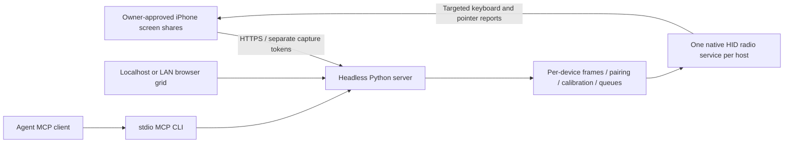

<div align="center">

# Open iPhone Use

**Give your AI agent real iPhones to use.**

Run a headless server. Open the web grid. Share each iPhone's screen and control it through Bluetooth keyboard/pointer HID.

[Setup](#get-started) · [Platform status](#platform-status) · [Server guide](docs/headless-server.md) · [Roadmap](ROADMAP.md)

**macOS / Linux / Windows source implementations · MCP · Apache-2.0**

</div>

## Get started

On **macOS or Linux**, from a downloaded source checkout:

```sh
sh setup.sh
open-iphone-use serve
```

Once these changes are merged to `main`, installation from GitHub is also:

```sh
curl -fsSL https://raw.githubusercontent.com/semsturgut/open-iphone-use/main/setup.sh | sh
```

For this development branch, use its checked-out `setup.sh`; the remote `main` script does
not acquire unmerged changes automatically. `OIU_REF` selects an archive ref for downloaded
installers; `OIU_SOURCE_DIR` selects a local checkout.

On **Windows**, download the source and run:

```powershell
.\setup.ps1
open-iphone-use serve
```

The installers create a private Python environment, install dependencies, build the native
Swift helper on macOS, register detectable **Codex, Claude Code and Cursor** clients, and
install the shared agent Skill. Linux uses BlueZ D-Bus; Windows installs native PyWinRT
bindings. Xcode/Swift 6 installation on Mac and owner/system permission approvals are still
required. Existing client settings are merged and backed up. Re-running setup updates the
managed install. [Installer options and uninstall](docs/installation.md).

### Pair first, then add each iPhone

1. Run `sh setup.sh`, then `open-iphone-use serve`. Approve the Mac Bluetooth permission
   prompt. For background use, run `open-iphone-use serve --daemon`; stop it later with
   `open-iphone-use stop`. Closing the launching terminal does not stop a daemon. It is
   not an automatic login/reboot service. The log is private at `~/.open-iphone-use/server.log`.
2. On an unlocked iPhone, enable AssistiveTouch and open **Settings → Accessibility →
   Touch → AssistiveTouch → Devices → Bluetooth Devices → Open iPhone Use**. Confirm the
   owner pairing prompts (Windows may advertise the PC name). Wait for both HID reports
   to connect. A Bluetooth pairing saved in settings alone is not a live connection.
3. Run `open-iphone-use new`. It lists connected, not-yet-added phones; choose one, or
   use `open-iphone-use new --bt <id>`. If exactly one is available, it is selected
   automatically. The device is permanently bound to that Bluetooth peer, gets its
   Bluetooth name and receives a private sharing link plus a terminal QR code.
   Alternatively open the printed localhost operator UI and select **Add phone** from
   **Bluetooth-connected phones**. There is no free-text Bluetooth onboarding form.
4. On first use, install the printed public CA on the iPhone, verify its SHA-256
   fingerprint against the terminal, and enable it under **Settings → General → About →
   Certificate Trust Settings**. The `new`/`link` output includes the CA download address
   and fingerprint. The localhost operator UI requires no desktop certificate trust.
5. Scan that phone's QR code **on that same iPhone**, open Safari and approve **Start
   sharing**. Each added phone appears immediately in the side-by-side grid with its
   own persistent Share/AirDrop, Copy and QR controls, Bluetooth status and sharing status.
   `open-iphone-use link <device>` reprints the private link and terminal QR at any time.
6. Tap its live screen to control it; the first tap automatically prepares that phone's
   pointer with Safari visible. CLI/MCP also provide keyboard, typing, scroll and release
   input. Both Bluetooth HID and fresh sharing are required. Inspect every resulting screen.
7. Use **Remove** beside a tile's link and confirm, or run `open-iphone-use remove <device>`
   (`remove --device <id>` also works). Removal cancels input, clears frames/calibration
   and permanently revokes that link. OS Bluetooth bonds and other phones remain intact.

For **two iPhones**, repeat pairing → `new` → scan for each. Select the exact Bluetooth
peer for each link; each phone has its own frames, calibration, action queue and targeted
HID reports. They can be prepared and controlled concurrently. On macOS a real name may
be unavailable: the safe label is `iPhone (abcd)`, never a guessed name from another phone.
If both names are unavailable, pair/add one at a time to identify the correct link.
Linux/Windows have real native implementations; adapter/driver and notification limits
still apply. Physical two-phone behavior requires verification on the owner's hardware.

The host browser is optional: setup, background serving, phone selection, link/QR display,
status, removal and control all work through CLI/MCP. Safari on each phone supplies capture.

With automatic LAN detection and generated certificates (the default), the HTTPS capture
and public-certificate listeners bind all IPv4 interfaces. The operator UI checks the
current LAN address every five seconds; a change renews the server certificate under the
same CA and updates all sharing links without restarting. Reopen the updated link on each
iPhone and approve sharing again. Startup terminal text and already copied links stay
unchanged. Explicit `--host` or custom `--cert`/`--key` configurations stay fixed; restart
with the new address and matching certificate for those configurations.

Keep the server and iPhones on the same trusted private Wi-Fi. Only the owner can pair,
trust certificates, unlock, approve capture or resume a stopped share. Close the legacy
standalone Mac app when using this server so it does not compete for the radio.

See the [HID backend audit](docs/hid-backend-audit.md) for UUID, encryption, pairing and
platform restrictions, and the boundary between software checks and real iPhone behavior.

## CLI and MCP

```sh
open-iphone-use devices
open-iphone-use status --device DEVICE_ID
open-iphone-use bluetooth              # connected HID candidates, names and IDs
open-iphone-use new --bt BLUETOOTH_ID   # select that exact connected phone
open-iphone-use link DEVICE_ID          # persistent link + terminal QR
open-iphone-use serve --daemon          # optional background server
open-iphone-use stop
open-iphone-use remove --device DEVICE_ID # remove phone and revoke its link
open-iphone-use action --device DEVICE_ID send_key \
  --arguments '{"expectedFrameID":"FRESH_FRAME_ID","key":"cmd+h"}'
open-iphone-use action --device DEVICE_ID stop_control
```

CLI clients discover the local server connection from private state. MCP clients launch
`open-iphone-use mcp`; installation registers this for detected clients. For manual setup:

```json
{
  "mcpServers": {
    "open-iphone-use": {
      "command": "/absolute/path/to/open-iphone-use",
      "args": ["mcp"]
    }
  }
}
```

Tools require an explicit `device_id`. Start with `list_devices`, read that phone's latest
screenshot, then call `ensure_session` with its `expected_frame_id`. Input remains serialized
per phone; stale/foreign frames block control. Stop bypasses the queue and releases held
input for that phone. Your image-capable MCP client supplies the model; no model API key
is required by the server. Screens sent to a remote model follow that provider's policies.

## How it works



macOS publishes one shared CoreBluetooth HID service with per-central notification targets.
Linux publishes encrypted BlueZ HOGP attributes and uses per-peer notification channels,
with a guarded single-phone-per-adapter fallback on BlueZ versions that share notifications.
Windows publishes encrypted WinRT GATT characteristics and targets a specific subscribed
client. Python runs the common keyboard/pointer, pairing association and image-checked
calibration logic. [Architecture](docs/architecture.md).

## Platform status

| Platform | Implementation | Evidence |
| --- | --- | --- |
| macOS | Shared native CoreBluetooth peripheral + headless HTTPS/web/MCP | Builds and automated tests pass; local automatic CLI server startup checked. New physical control path not yet hardware-verified. |
| Linux | BlueZ D-Bus HID service, report/reference attributes, advertising, owner-confirmed pairing agent, per-peer channels and guarded fallback | Implemented, not yet hardware-verified. Multiple phones on older shared-notify BlueZ paths require separate capable adapters. |
| Windows | WinRT GATT HID service, encrypted reads/writes/notifications, report references and targeted subscribers | Implemented, not yet hardware-verified. Requires a peripheral-capable driver and permitted Bluetooth access. |

Several software device sessions are supported concurrently. Actual phone counts depend
on the adapter, OS and driver; no universal hardware capacity is claimed. Tests using
synthetic screens and transport doubles do not establish real iPhone behavior. See the
[validation record](docs/web-server-validation.md) and [platform setup](docs/headless-server.md).
The latest agent-context Mac smoke reported `peripheralUnsupported` with no subscribed
phones; its successful web/TLS checks do not establish physical HID readiness.

## Optional / legacy Mac app

The existing development-signed, non-notarized **0.0.2 DMG** remains available in
[Releases](https://github.com/semsturgut/open-iphone-use/releases). It is optional. With
`OIU_SERVER_URL=http://127.0.0.1:27893`, its executable displays the server grid without
starting its own radio/receiver. Without that variable it retains the original standalone
single-phone workflow. [Mac development and legacy app](macos/README.md).

The existing demo and [device matrix](docs/device-matrix.md) describe the earlier
standalone Mac path, not physical verification of the new cross-platform server:

https://github.com/user-attachments/assets/9faccc34-7bd1-4714-a1a4-e8bb747bfb53

No iPhone Mirroring, automatic unlock, protected-content bypass or system-permission
bypass is used. Text uses the US ASCII keyboard layout. HID delivery alone does not prove
UI success. The server is intended for a trusted LAN, not direct internet exposure.

## Development

```sh
python3 -m venv .venv
.venv/bin/python -m pip install ./server
swift build --package-path macos
swift test --package-path macos
PYTHONPATH=server .venv/bin/python -m unittest discover -s server/tests -v
node macos/scripts/test-capture-page.mjs
```

[Contributing](CONTRIBUTING.md) · [Security](SECURITY.md) · [Roadmap](ROADMAP.md)

## License

[Apache License 2.0](LICENSE). Not affiliated with Apple or any model provider.
