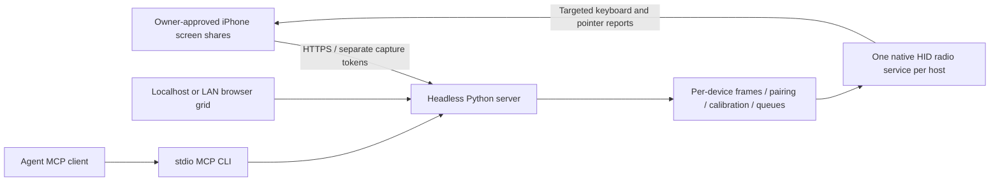

<div align="center">

# Open iPhone Use

**Give your AI agent real iPhones to use.**

Run a headless server. Open the web grid. Share each iPhone's screen and control it through Bluetooth keyboard/pointer HID.

[Setup](#get-started) · [Platform status](#platform-status) · [Server guide](docs/headless-server.md) · [Roadmap](ROADMAP.md)

**macOS / Linux / Windows source implementations · MCP · Apache-2.0**

</div>

## Get started

On **macOS or Linux**, from a downloaded source checkout:

```sh
sh setup.sh
open-iphone-use serve
```

Once these changes are merged to `main`, installation from GitHub is also:

```sh
curl -fsSL https://raw.githubusercontent.com/semsturgut/open-iphone-use/main/setup.sh | sh
```

For this development branch, use its checked-out `setup.sh`; the remote `main` script does
not acquire unmerged changes automatically. `OIU_REF` selects an archive ref for downloaded
installers; `OIU_SOURCE_DIR` selects a local checkout.

On **Windows**, download the source and run:

```powershell
.\setup.ps1
open-iphone-use serve
```

The installers create a private Python environment, install dependencies, build the native
Swift helper on macOS, register detectable **Codex, Claude Code and Cursor** clients, and
install the shared agent Skill. Linux uses BlueZ D-Bus; Windows installs native PyWinRT
bindings. Xcode/Swift 6 installation on Mac and owner/system permission approvals are still
required. Existing client settings are merged and backed up. Re-running setup updates the
managed install. [Installer options and uninstall](docs/installation.md).

### Open the web UI and connect iPhones

`serve` prints the private localhost operator link, an iPhone sharing link, the public CA
certificate URL and its fingerprint. It selects the host's native Bluetooth backend and
creates/reuses HTTPS certificates automatically. No DMG, app window, backend JSON or
Bluetooth UUID configuration is required.

1. Open the printed **localhost web UI** (normally `http://127.0.0.1:27893`). Its operator
   link logs you in. This loopback UI needs no certificate installation on the host.
2. Install the public CA on each iPhone, checking its fingerprint against the terminal,
   and explicitly enable it under **Settings → General → About → Certificate Trust Settings**.
   The public certificate can be downloaded from the printed HTTP link or transferred
   through a trusted channel. Its private key stays on the server.
3. Enable **AssistiveTouch** on each unlocked iPhone. Under **Touch → AssistiveTouch → Devices →
   Bluetooth Devices**, pair with **Open iPhone Use** (Windows may show the PC name).
   Approve the host Bluetooth prompt and the phone's pairing confirmation. On headless
   Linux, the server asks the owner to confirm pairing codes in its terminal.
4. Open the same printed **private HTTPS sharing invitation** in Safari on each iPhone.
   Each browser gets its own device identity and capture token. Tap **Start sharing** and
   approve iOS sharing. New screens appear automatically as separate tiles.
5. Use **Prepare** in a tile, or ask your MCP agent to prepare that device. Keep Safari
   visible while the pointer is measured. Bluetooth peers are associated automatically;
   no central IDs need to be copied. Then tap the screen, type, use keyboard shortcuts
   or scroll from that tile. Inspect the result after every action.

Keep the server and iPhones on the same trusted private Wi-Fi. Only the owner can pair,
trust certificates, unlock, approve capture or resume a stopped share. Close the legacy
standalone Mac app when using this server so it does not compete for the radio.

## CLI and MCP

```sh
open-iphone-use devices
open-iphone-use status --device DEVICE_ID
open-iphone-use add "Named test iPhone"  # optional named sharing link
open-iphone-use action --device DEVICE_ID send_key \
  --arguments '{"expectedFrameID":"FRESH_FRAME_ID","key":"cmd+h"}'
open-iphone-use action --device DEVICE_ID stop_control
```

CLI clients discover the local server connection from private state. MCP clients launch
`open-iphone-use mcp`; installation registers this for detected clients. For manual setup:

```json
{
  "mcpServers": {
    "open-iphone-use": {
      "command": "/absolute/path/to/open-iphone-use",
      "args": ["mcp"]
    }
  }
}
```

Tools require an explicit `device_id`. Start with `list_devices`, read that phone's latest
screenshot, then call `ensure_session` with its `expected_frame_id`. Input remains serialized
per phone; stale/foreign frames block control. Stop bypasses the queue and releases held
input for that phone. Your image-capable MCP client supplies the model; no model API key
is required by the server. Screens sent to a remote model follow that provider's policies.

## How it works



macOS publishes one shared CoreBluetooth HID service with per-central notification targets.
Linux publishes encrypted BlueZ HOGP attributes and uses per-peer notification channels,
with a guarded single-phone-per-adapter fallback on BlueZ versions that share notifications.
Windows publishes encrypted WinRT GATT characteristics and targets a specific subscribed
client. Python runs the common keyboard/pointer, pairing association and image-checked
calibration logic. [Architecture](docs/architecture.md).

## Platform status

| Platform | Implementation | Evidence |
| --- | --- | --- |
| macOS | Shared native CoreBluetooth peripheral + headless HTTPS/web/MCP | Builds and automated tests pass; local automatic CLI server startup checked. New physical control path not yet hardware-verified. |
| Linux | BlueZ D-Bus HID service, report/reference attributes, advertising, owner-confirmed pairing agent, per-peer channels and guarded fallback | Implemented, not yet hardware-verified. Multiple phones on older shared-notify BlueZ paths require separate capable adapters. |
| Windows | WinRT GATT HID service, encrypted reads/writes/notifications, report references and targeted subscribers | Implemented, not yet hardware-verified. Requires a peripheral-capable driver and permitted Bluetooth access. |

Several software device sessions are supported concurrently. Actual phone counts depend
on the adapter, OS and driver; no universal hardware capacity is claimed. Tests using
synthetic screens and transport doubles do not establish real iPhone behavior. See the
[validation record](docs/web-server-validation.md) and [platform setup](docs/headless-server.md).
The latest agent-context Mac smoke reported `peripheralUnsupported` with no subscribed
phones; its successful web/TLS checks do not establish physical HID readiness.

## Optional / legacy Mac app

The existing development-signed, non-notarized **0.0.2 DMG** remains available in
[Releases](https://github.com/semsturgut/open-iphone-use/releases). It is optional. With
`OIU_SERVER_URL=http://127.0.0.1:27893`, its executable displays the server grid without
starting its own radio/receiver. Without that variable it retains the original standalone
single-phone workflow. [Mac development and legacy app](macos/README.md).

The existing demo and [device matrix](docs/device-matrix.md) describe the earlier
standalone Mac path, not physical verification of the new cross-platform server:

https://github.com/user-attachments/assets/9faccc34-7bd1-4714-a1a4-e8bb747bfb53

No iPhone Mirroring, automatic unlock, protected-content bypass or system-permission
bypass is used. Text uses the US ASCII keyboard layout. HID delivery alone does not prove
UI success. The server is intended for a trusted LAN, not direct internet exposure.

## Development

```sh
python3 -m venv .venv
.venv/bin/python -m pip install ./server
swift build --package-path macos
swift test --package-path macos
PYTHONPATH=server .venv/bin/python -m unittest discover -s server/tests -v
node macos/scripts/test-capture-page.mjs
```

[Contributing](CONTRIBUTING.md) · [Security](SECURITY.md) · [Roadmap](ROADMAP.md)

## License

[Apache License 2.0](LICENSE). Not affiliated with Apple or any model provider.
