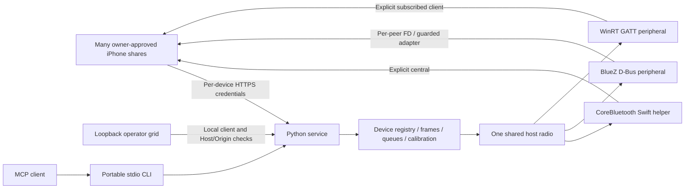

# Architecture

The headless Python service owns HTTP/TLS, enrollment, screen stores, pairing association,
calibration, per-device input queues, web controls, CLI and MCP. Swift remains the macOS
native radio and the optional native app. Linux and Windows use real OS peripheral APIs.

Python 3.11+ keeps session/action logic portable; Pillow provides the measured calibration
board/pointer gate, cryptography manages a private CA/renewed leaf certificates, and tomlkit
preserves Codex configuration during installer registration. Platform-specific imports are
lazy. macOS uses a native Swift helper over a same-user Unix socket, Linux uses dbus-fast,
and Windows uses native PyWinRT projections in an owned MTA asyncio loop.

The `radio.peers/send/release/close` boundary sends report ID + bytes to a concrete native
peer. It never encodes an implicit current phone. `Control` wraps a radio with one device's
calibration, frame waits, pointer/keyboard state, stop generation and pairing binding.
Capture uploads/tap/hover feedback stay concurrent with actions waiting for new images.
The registry adds separate credentials, bounded action acceptance and stale/foreign frame
checks. Preparation and actions serialize only per device; no global association/calibration
lock is held. The owner selects an exact live HID peer before a device/capture link exists.
The binding is persistent and immutable: stopping a share never transfers it to another
phone. Unbound legacy records cannot emit input. Calibration clicks require a measured
board and visible pointer; HID acceptance does not establish the resulting UI behavior.

TLS capture and the operator grid are separate listener roles: LAN HTTPS serves capture
and scoped capture APIs, a loopback HTTP listener avoids desktop certificate installation,
and an HTTP bootstrap endpoint serves only public CA bytes. Operator access is trusted only on the loopback listener with local clients and Host/Origin
checks. The LAN listener accepts per-device capture tokens, never operator requests. CLI/MCP discover the loopback
connection from private state rather than requiring manual URL/CA configuration.

## Native service details

- macOS: one CoreBluetooth manager and HID service; independent central subscriptions,
  FIFO queues, last-report state, readiness-driven backpressure/cancellation and targeted release. The old single-phone Swift
  controller remains intact for standalone-app compatibility and legacy checks.
- Linux: exported ObjectManager/service/characteristic/descriptor tree, encrypted HOGP,
  connectable advertising, owner-confirmed pairing, and per-peer acquired notification
  sockets. Shared-notify fallbacks refuse ambiguity and require one central per adapter.
- Windows: peripheral capability checks, encrypted GATT service/attributes, deferred
  read/write handlers, native event cleanup and explicit subscriber notification results.

All three implementations exist. Linux/Windows and the new physical multi-phone control
path are not yet hardware-verified. Radio/OS limits are operational constraints, not
features that software can promise away. [Platform setup](headless-server.md).

## CLI-only distribution

setup.sh/setup.ps1 install the Python CLI and platform-native HID implementation; macOS
builds the headless Swift helper. There is no application-bundle/disk-image build path.
The legacy Swift stdio helper remains for protocol compatibility tests. Session preparation
uses its own delayed-frame observations; other input uses a bounded two-second frame-ID
ring. Image waits and control queues are per device.
