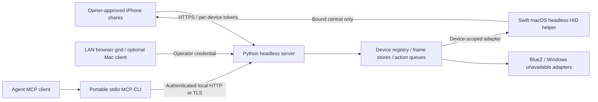

# Architecture

The portable headless server in `server/oiu` owns web capture and multi-device sessions.
The existing macOS app is optional: it can display that server's web UI, or continue using
its original standalone controller. The old Swift stdio MCP helper remains compatible
with standalone mode; the portable CLI supplies multi-device MCP.

Python 3.11+ provides a portable dependency-free server runtime. Native frameworks are
kept in platform adapters instead of leaking into session/HTTP/MCP code. Swift preserves
the tested macOS report encoder, CoreBluetooth implementation, pointer calibration and
inspect/action/inspect workflow. No model is embedded in either runtime.

Each enrolled device owns a persistent ID and capture token, an in-memory latest JPEG
and recent frame-ID history, a cancellation generation, a bounded action queue and a HID
adapter. Capture/tap ingress remains concurrent with input so calibration can wait for
fresh frames. The operator credential can inspect/control all devices; capture credentials
cannot issue input. Native routes explicitly bind a Bluetooth central and namespace
calibration. A headless helper owns no HTTPS receiver or SwiftUI application lifecycle.
The Mac client's `OIU_SERVER_URL` mode starts no legacy controller.

The web grid polls authenticated atomic snapshots, creates tiles on first upload and
passes the displayed frame ID with input. A stale/foreign frame blocks input. Stop bypasses
queued actions, invalidates their generation and releases keys/buttons. Capture expiry
also releases input. Frames are kept in memory only; credentials are stored privately.

Actual multi-phone radio support is not established by multiple software sessions. The
macOS peripheral remains single-central per helper, and simultaneous helpers on one radio
need physical verification. Linux and Windows HID currently return unavailable. See
[setup, API behavior, adapter contracts and implementation plans](headless-server.md).

## Standalone Mac compatibility

With no server URL, the app still owns its original single-phone receiver and controller:
private Wi-Fi HTTPS on port 27890, local CA and installation token, latest-frame store,
CoreBluetooth peripheral, serialized actions and same-user Unix broker. The bundled Swift
MCP helper forwards to that broker. Existing build/DMG scripts retain their paths and
resources. The portable server uses port 27891 and a separate state directory by default.
It does not migrate legacy capture links, credentials or pairings automatically.

The original two-click mapping remains device/profile/version/aspect-bound, and can
require recalibration after pointer setting changes. Only the owner can approve capture,
trust, pairing or unlocking. Input delivery does not prove a UI outcome. See
[security](../SECURITY.md), [feed control](feed-control.md) and [device evidence](device-matrix.md).
