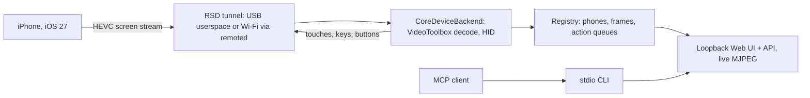

# Architecture

- **`coredevice.py`** opens one tunnel per phone: over USB, pymobiledevice3's in-process
  userspace tunnel (no root); over Wi-Fi, the tunnel macOS's `remoted` already keeps for a
  paired phone. It starts the display service's HEVC stream, reuses pymobiledevice3's VNC
  pipeline (RTP depacketizing, VideoToolbox decode, keyframe recovery and the RTCP keepalive)
  and turns frames into JPEGs. Touches and keys go to dtuhidd's universal HID service, which
  only accepts input while that stream runs; buttons go through Indigo HID.
- **`core.py`** keeps each phone's latest frame and a frame-ID history, and serializes actions
  per phone. Input needs a frame captured after the phone's last input, at most 120 seconds
  old, while the screen is live.
- **`http.py`** serves the Web UI, the JSON API and a live MJPEG stream per phone on loopback.
- **`mcp.py`** is a stdio MCP server that calls that API.

One USB phone per server process: pymobiledevice3's userspace network stack is process-global.
Wi-Fi phones ride `remoted`'s tunnels and can be added alongside it; their video goes to a host
kernel socket, while the USB phone's goes to the userspace stack.
