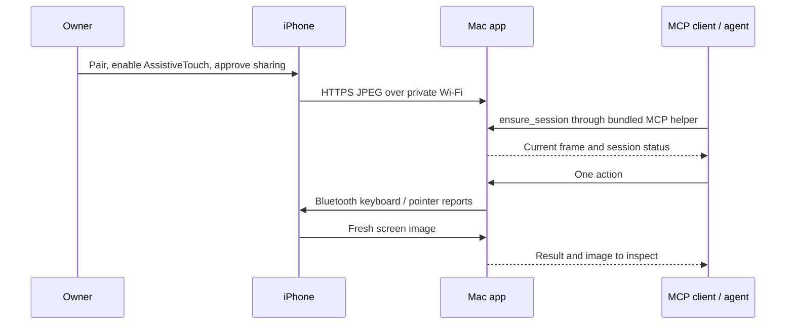

# Current architecture

Open iPhone Use runs on a Mac and controls one paired iPhone. The Mac app owns Bluetooth,
local screen reception and action serialization. Its bundled helper exposes standard MCP
stdio tools to a model-capable client. No standalone service or provider adapter is needed.

## Mac processes

- `OpenIPhoneUseMac`: SwiftUI onboarding/preview, CoreBluetooth HID peripheral, HTTPS
  receiver, calibration and serialized action execution.
- `open-iphone-use-mcp`: official Swift MCP SDK over stdio. It forwards requests through a
  same-user Unix socket; it neither advertises Bluetooth nor exposes a network listener.
- Support directory: `~/Library/Application Support/Open iPhone Use`. The local token,
  certificate private keys and same-user socket belong to this installation.

MCP clients register their own executable path once. New chats receive the workflow
through MCP initialization. The model must support screenshots and follow the supplied
inspect/action/inspect contract. No model or AI key is embedded in Open iPhone Use.

## Capture sources

The default demo uses the HTTPS Safari page served by the Mac. The owner approves
screen capture. Its upload responses carry the current capture rate, calibration-board
state/epoch and page version. Keep Safari visible for calibration; compatible mapping
is reused when switching apps. The page's keep-alive behavior has been tested on one
phone, but iOS can still pause or end capture.

The optional native iPhone app uses ReplayKit and the same receiver token. It can upload
while its containing app is backgrounded. It is a capture source, not an input injector.
The automatic calibration-board orchestration currently belongs to the Safari page;
native capture alone does not implement that board protocol. Do not claim this alternate
source has the full default onboarding flow or every background scenario verified.

## Local HTTP contract inside HTTPS

The receiver listens on private Wi-Fi IPv4 port 27890 and checks the connecting subnet.
The capture page uses the installation token in its link; API calls use
`X-Open iPhone Use-Token`. Other than the capture page, no credential is passed in a query.

| Endpoint | Purpose |
| --- | --- |
| `GET /capture?token=…` | Owner-facing sharing page |
| `POST /api/frame` | Bounded JPEG; returns server frame ID/time and page controls |
| `GET /api/status` | Authenticated capture status |
| `POST /api/stop` | Mark capture inactive and release input through the watchdog |
| `POST /api/calibrate` | Read-only readiness check, or explicit serialized preparation |
| `POST /api/tap` | Calibration-board landing feedback, not an input command |

Only the newest JPEG stays in Mac memory. Frame IDs/time retained for age guards do
not retain older images. Input requires live capture no older than five seconds.
The private receiver is not a remote MCP endpoint and does not expose arbitrary app commands.

## Input and verification

The phone sees keyboard and relative-pointer HID reports. Absolute screen fractions are
mapped through a calibration bound to device identity, aspect, profile and motion version.
Automatic preparation measures two board clicks without searching profiles. The result
is a two-point estimate, not a full-screen accuracy guarantee. Models reuse it through
`ensure_session`; changes to pointer settings can require explicit `prepare_session`.

Lists use `scroll`; full-screen video uses centered press/drag/release `advance_feed`.
Input is serialized. Stop cancels queued work and attempts to release all held keys and
buttons. A newer frame is returned after actions, but an unfinished transition can require
another screenshot. Never infer success from BLE acceptance alone. See [feed control](feed-control.md).

Read [security](../SECURITY.md) and [device checks](device-matrix.md) for practical boundaries.
